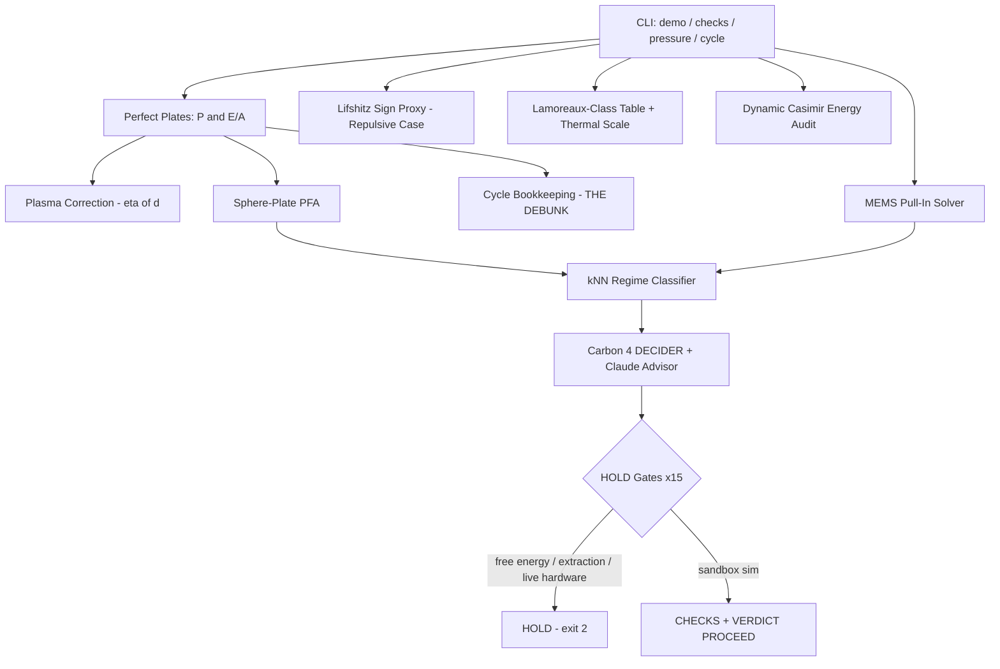
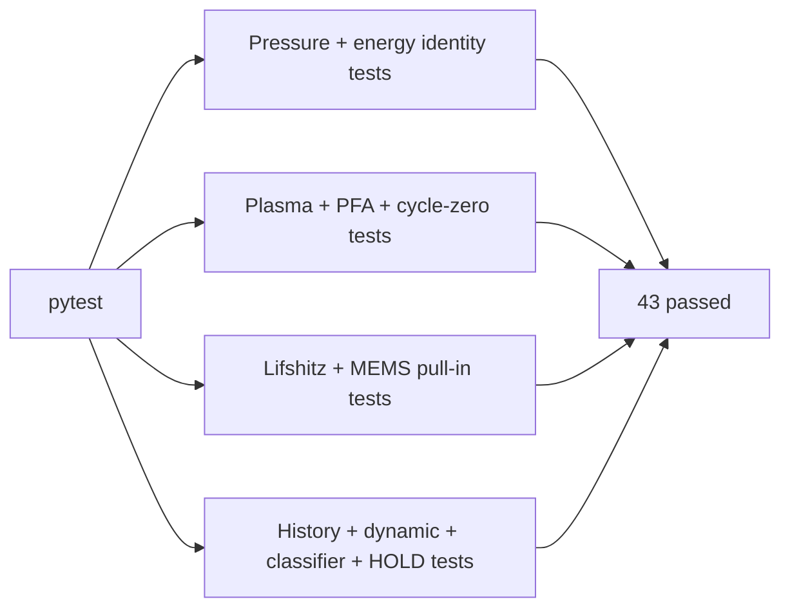
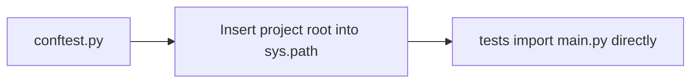
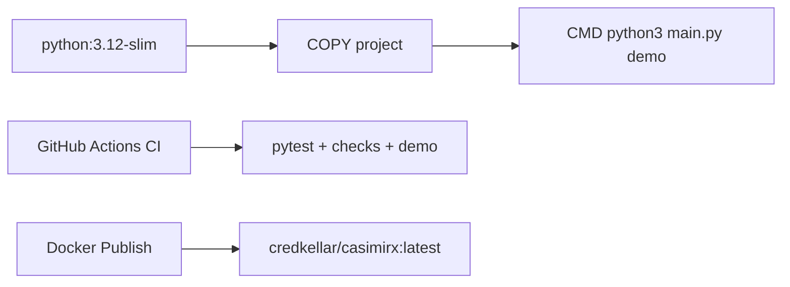

# CasimirX 🌌🌀

**Casimir Effect Vacuum Physics Lab** — an educational Casimir-effect lab in ONE pure-Python file, by Darion Kellar. The **exact Casimir pressure** P = −π²ħc/(240 d⁴), the parallel-plate energy, the **sphere–plate force** by the proximity force approximation, a labelled **plasma-model correction** for real metals, a simplified **Lifshitz sign model** with the repulsive case, **MEMS pull-in** (why micro-chips stick shut), **Lamoreaux-1997-class** force tables, and a **dynamic Casimir** energy audit. And the honest headline: **this lab debunks vacuum-energy extraction with its own math** — the cycle bookkeeping shows the net work over any closed plate cycle is exactly zero, joule for joule. Simulation and learning only — every real-world operation and every free-energy claim sits behind a permanent HOLD gate (15 total). 🔒


> ℹ️ The two workflow badges above are the **live** GitHub Actions badges for this repo — they light up as soon as the `ci.yml` and `docker-publish.yml` files from the paste pack are pasted into `.github/workflows/`.

## 🧰 Tech Stack Badges & Full Architecture Tech Stack

### 💻 Core Programming Languages & Core Systems


- 🐍 Python 3.12, pure standard library (`math`, `hashlib`, `json`, `sys`) — ONE file: `main.py`
- 🌀 Physics core: exact Casimir pressure + plate energy (with the P = −d(E/A)/dd consistency identity verified numerically), plasma-model finite-conductivity correction, Derjaguin proximity force approximation for sphere–plate, Lifshitz sign proxy, MEMS spring-vs-Casimir pull-in solver (bisection), dynamic Casimir energy audit
- 🧠 TinyML kNN regime classifier (from scratch, stdlib) on (log₁₀ gap, log₁₀ area, log₁₀ pressure)
- 🧑‍⚖️ Advisory seats inside `main.py`: Gemini Carbon 4 DECIDER (names-only, tighten-only, sha256 trace), Muse advisor (can_override_hold = False), Google Flow plan-only (rendered = False, live = 0)

### ⛓️ Web3 & Infrastructure

Not used — this lab is an offline physics simulation. No blockchain, no Web3 libraries, no network calls of any kind.

### ⚙️ Platform Support & Hardware Architecture


- 🖥️ Runs anywhere Python 3.12 runs — Linux, macOS, Windows, any CPU architecture
- 🚫 Controls **no hardware**: no AFM rigs, vacuum chambers, or nanofabrication tools (all behind HOLD gates)

### ⚡ Low-Level Infrastructure & Performance


- 🚀 Zero dependencies, zero network, zero install friction for the lab itself
- 🎯 Deterministic end to end: run it twice, get byte-identical output
- 🔢 Closed-form physics throughout — the only iteration is a bisection solver for the MEMS equilibrium and the kNN sort

### 🛠️ DevOps & Build Tools


- 🐳 Docker image (`python:3.12-slim`), target: `credkellar/casimirx:latest`
- ⚙️ GitHub Actions CI + Docker Publish workflows — delivered in the paste pack for `.github/workflows/`

### ☁️ Cloud Providers

Not used — this lab runs fully offline on your own machine or in a local Docker container. No cloud account, no API keys, no hosted services.

## What this does?

1. 🧲 **Perfect plates, exact** — Casimir's 1948 result in closed form: P(d) = −π²ħc/(240 d⁴). At d = 1 µm the pressure is −1.300 mPa; at 100 nm, −13.00 Pa; at 10 nm, −1.30×10⁵ Pa — more than an atmosphere of vacuum push. The d⁻⁴ scaling is asserted *exactly*: 10× closer = 10,000× stronger.
2. ⚖️ **Energy bookkeeping** — the plate energy per area E/A = −π²ħc/(720 d³), and the lab verifies the thermodynamic identity P = −d(E/A)/dd numerically, so pressure and energy can never drift apart in the code.
3. 🪙 **Real-metal correction** — perfect mirrors are a ceiling, not a product. A labelled first-order plasma-model factor η(d) = 1 − (4/3)(δp/d) with gold's δp = c/ωp = 21.9 nm cuts the force to η = 0.971 at 1 µm, 0.942 at 500 nm, 0.854 at 200 nm — always *below* the ceiling.
4. 🔮 **Sphere–plate geometry** — the proximity force approximation (Derjaguin): F = 2πR·(E/A) = −π³ħcR/(360 d³). A 100 µm sphere at 100 nm feels −2.72×10⁻¹⁰ N, and the PFA result is asserted equal to the closed form. This d⁻³ law is what real experiments measure.
5. 🚫 **THE DEBUNK** — close the plates and the field pays out 4.33×10⁻¹¹ J (1 cm², 1 µm → 100 nm); pull them apart again and you pay back 4.33×10⁻¹¹ J. Net cycle gain: **exactly 0.0 J**, for any geometry, because the energy is a state function of the gap. The "Casimir cycle engine" hides the separation invoice; this lab prints it.
6. 🔀 **Repulsive Casimir** — a simplified Lifshitz sign model (static-permittivity ordering, labelled as a proxy): gold | bromobenzene | silica **repels** — the Munday–Capasso–Parsegian 2009 configuration — while gold | vacuum | gold and gold | vacuum | silica attract. The sign flips only with the dielectric ordering ε₁ > ε_medium > ε₂.
7. 📌 **MEMS stiction / pull-in** — a (100 µm)² plate on a 1 N/m spring: stable only above the pull-in gap (4·C_A/k)^⅕ = 139.1 nm, and no equilibrium exists at all below the critical rest gap 173.9 nm. At g₀ = 150 nm the plate snaps shut; at g₀ = 200 nm it settles at 190.0 nm. This is why micro-machines weld themselves down in the fab.
8. 📜 **Measurement history** — a labelled ideal-PFA table for Lamoreaux's 1997 geometry (R = 11.3 cm sphere): −1.42 nN at 0.6 µm, −3.08×10⁻¹⁰ N at 1 µm, falling as d⁻³ — the scale and law of the experiment that opened the modern era (not its raw data). Plus the thermal wavelength ħc/(k_BT) = 7.63 µm at 300 K, the scale where thermal photons join in.
9. 🎞️ **Dynamic Casimir audit** — a labelled concept check: a MEMS mirror flapping 1 nm at 10 GHz reaches v = 62.8 m/s = 2.1×10⁻⁷ c, and its photons (~5 GHz, 3.3×10⁻²⁴ J each) are paid for out of the mirror's drive energy. Energy out ≤ energy in, asserted. Not a power source.
10. 🏷️ **kNN regime classifier** — labels any (gap, area) point `measurable` / `MEMS-relevant` / `negligible` from physical features: lab plates at 100 nm measure, an 80 nm MEMS plate is stiction country, plates 10 µm apart are negligible.
11. 🧠 **Advisory seats + checks** — Carbon 4 DECIDER with sha256 trace, Muse advisor, Google Flow plan-only, and a built-in CHECKS suite (56 checks).

## 🗺️ How it works — diagram per script

### `main.py` — the whole lab



### `tests/test_main.py` — verification



### `conftest.py` — test path setup



### `Dockerfile` + CI — container & workflow flow



## Why is this cool?

1. 🌀 Empty space pushes — measurably. Two uncharged plates with nothing between them attract because the vacuum outside has more modes than the vacuum inside, and this lab puts the exact number on it.
2. 📈 The d⁻⁴ law is savage: one decade of distance costs four decades of force. No other everyday force law turns that fast, and the lab asserts the ratio to machine precision.
3. 🚫 It debunks with arithmetic, not adjectives: the extraction cycle's net gain is not "small" or "impractical" — it is exactly 0.0, printed from the state function itself.
4. 🪙 The perfect-mirror number is treated as what it is — a ceiling. Real gold gives back 97 cents on the dollar at 1 µm and 85 at 200 nm, and the correction is labelled with its method and its limits.
5. 🔀 The vacuum can push *apart*: one dielectric sandwich (gold–bromobenzene–silica) flips the sign, and the lab shows the ordering rule that decides it.
6. 📌 It explains a factory problem: MEMS pull-in — the gap where the vacuum literally out-pulls a spring and welds a micro-part down — falls out of one fifth-root formula.
7. 📜 It reproduces the scale of the 1997 measurement that proved the effect to 5%: nano-newtons at sub-micron gaps, with the d⁻³ sphere law.
8. 🎞️ Even the exotic dynamic Casimir effect gets an honest audit: photons yes, free power no — the drive pays, at v/c ≈ 2×10⁻⁷.
9. 🏷️ A tiny from-scratch ML classifier learns the map of where the effect matters: the bench, the chip, or nowhere.
10. 🎯 Deterministic end to end: run it twice, get byte-identical output — vacuum physics you can diff.

## What problems this solves?

1. ❌ **Problem:** "Vacuum energy" is marketed as an untapped power source. ✅ **Solution:** The cycle bookkeeping module computes work out and work in from the same state function and shows the net is exactly zero — for any plate size and any gap pair.
2. ❌ **Problem:** Casimir forces get quoted from the perfect-mirror formula as if real metals reach it. ✅ **Solution:** The plasma-model correction is computed next to the ceiling everywhere, with gold's plasma scale and the method's validity range stated.
3. ❌ **Problem:** People picture two flat plates in experiments that actually use a sphere. ✅ **Solution:** The PFA sphere–plate force is derived from the plate energy and matched to its closed form, with the different d⁻³ law made explicit.
4. ❌ **Problem:** "Repulsive Casimir" sounds like antigravity. ✅ **Solution:** The Lifshitz sign module shows repulsion is a dielectric-ordering effect between specific materials across a liquid — and antigravity claims are a permanent HOLD gate.
5. ❌ **Problem:** MEMS stiction is treated as glue or contamination. ✅ **Solution:** The pull-in solver shows pure Casimir attraction snapping a sprung plate shut below a computable gap — no glue required.
6. ❌ **Problem:** The effect's size is impossible to intuition-check (mPa? nN?). ✅ **Solution:** One table runs 10 nm → 1 µm across pressure, energy, force on 1 cm², and the Lamoreaux geometry, all from the same constants.
7. ❌ **Problem:** Dynamic Casimir headlines imply energy from nothing. ✅ **Solution:** The audit compares photon energy to the mirror's kinetic energy and asserts the drive pays — ratio printed, direction fixed.
8. ❌ **Problem:** Thermal photons are forgotten in room-temperature estimates. ✅ **Solution:** The thermal wavelength at 300 K (7.63 µm) is computed and named as the scale where the zero-temperature formula stops being the whole story.
9. ❌ **Problem:** Physics code usually needs numpy / scipy installs. ✅ **Solution:** Pure standard library — runs anywhere Python 3.12 runs, zero pip installs for the lab itself.
10. ❌ **Problem:** Simulation tools quietly imply engineering readiness. ✅ **Solution:** Model constants are labelled as model values, the Lifshitz module is labelled a sign proxy, and 15 HOLD gates return exit code 2 for every live operation and every extraction claim.

## How to install this?

1. 📋 Clone or download this project folder.
2. 🐍 Make sure Python 3.12+ is installed: `python3 --version`
3. ▶️ Run the full demo + checks (no arguments needed):

```bash
python3 main.py
```

4. 🧪 Run the test suite:

```bash
pip install pytest
python3 -m pytest -q
```

5. 🎛️ Try the other commands:

```bash
python3 main.py checks    # 56 built-in checks
python3 main.py pressure  # pressure / energy / force table as JSON
python3 main.py plasma    # plasma correction vs gap
python3 main.py geometry  # plate vs sphere-plate forces
python3 main.py cycle     # THE DEBUNK: cycle bookkeeping as JSON
python3 main.py lifshitz  # sign table: which sandwiches repel
python3 main.py mems      # MEMS pull-in: equilibria vs rest gap
python3 main.py history   # Lamoreaux-class force table as JSON
python3 main.py dynamic   # dynamic Casimir energy audit as JSON
python3 main.py classify  # kNN regime verdicts
python3 main.py brains    # Carbon 4 + Muse + Flow seats
python3 main.py holds     # list all 15 HOLD gates
python3 main.py hold-demo # exits 2 - gated actions stay HOLD
```

6. 🐳 Or run it in Docker:

```bash
docker build -t credkellar/casimirx:latest .
docker run --rm credkellar/casimirx:latest
```

## Requirements

- 🐍 Python 3.12 or newer
- 📦 Dependencies: **none** (standard library only)
- 🌐 Network: **none** — fully offline
- 🧪 For tests only: `pytest`
- 🐳 Optional: Docker

## FULL project structure tree

```text
casimirx/
├── main.py                  # the whole lab: plates, plasma correction, PFA, cycle debunk, Lifshitz sign, MEMS pull-in, history, dynamic audit, classifier, seats, HOLD gates
├── conftest.py              # puts the project root on sys.path for tests
├── tests/
│   └── test_main.py         # 43 pytest tests: pressure, energy identity, plasma, PFA, cycle, Lifshitz, MEMS, history, dynamic, gates, determinism
├── assets/
│   └── cover.png            # README cover image (2736 x 912)
├── Dockerfile               # python:3.12-slim, runs the demo
├── .gitignore               # __pycache__, .pytest_cache, *.pyc
└── README.md                # this file
```

> 📦 Delivered separately as paste packs (not in this tree): `.github/workflows/ci.yml` + `docker-publish.yml`, and the Docker Hub pack (100-char description, 350-char About, overview, categories).

## 🔒 HOLD gates — all 15, permanent

| Gate | Rule |
|---|---|
| free_energy_claim | The Casimir force is conservative; net cyclic work is zero, no free energy |
| perpetual_motion_claim | No perpetual motion: separating the plates costs exactly what closing pays back |
| vacuum_energy_extraction_claim | Zero-point energy between plates cannot be cycled into net work; the debunk math is in this lab |
| real_hardware_control | No control of any real Casimir rig, AFM, or vacuum hardware, ever |
| live_experiment | No live experiment instructions; this lab computes, it does not operate |
| commercial_product_claim | Educational lab, not a commercial product or device design |
| propulsion_claim | Casimir forces act between the plates themselves; they propel nothing |
| medical_claim | No medical claims |
| investment_claim | No investment advice about vacuum-energy, MEMS, or quantum companies |
| guaranteed_device_performance_claim | No guaranteed device performance; every model carries its assumptions |
| nanofabrication_live | No live nanofabrication recipes; the MEMS pull-in model is not a process flow |
| high_vacuum_operation_live | No live high-vacuum operation instructions for hardware builds |
| antigravity_claim | An attraction (or repulsion) between plates, not antigravity |
| overunity_claim | Overunity is arithmetically false here: cycle work in = cycle work out, exactly |
| weapons_application_claim | No weapons application guidance of any kind |

🧑‍⚖️ **Seats:** Gemini Carbon 4 DECIDER (MAP→MODEL→STRESS→DECIDE, names-only, tighten-only, sha256 trace) · Muse advisor (can_override_hold = False) · Google Flow plan-only (rendered = False, live = 0).

✅ **Verification:** pytest 43 passed · CHECKS 56/56 · double-run byte-identical · hold-demo exits 2.

## 🧒 5th-grade English section

Imagine two metal plates in a dark, empty box, very, very close together — closer than a hair is wide. Nobody pushes them. But they slowly move toward each other anyway. 🧲

- The "empty" space is not really empty. It fizzes with tiny waves, like a quiet sea. 🌊
- Outside the plates, waves of **every** size can fit. Between the plates, only **short** waves fit — the long ones cannot squeeze in.
- More waves outside means more tiny pushes outside, so the plates get pushed **together**. That push is called the **Casimir effect**.
- The closer the plates, the stronger the push — *much* stronger. Ten times closer means **ten thousand** times stronger! 📈
- Some people dream of using this push as free power. Here is the catch this project proves with math: pulling the plates apart again costs **exactly** the energy you got when they came together. You always pay back every bit. The total gain is **zero**. 🚫
- Sometimes, with the right liquid between special plates, the push flips and pushes them **apart** instead. Same sea, different sandwich. 🔀
- This push is also why tiny machine parts inside chips sometimes **stick shut** and break. Engineers have to design around the vacuum! 📌
- This project is a **pretend lab on a computer**. It does the math of the vacuum's push — it does not build anything or touch anything real. 💻

---

MIT © 2026 Darion Kellar · CasimirX — educational simulation only 🌌
